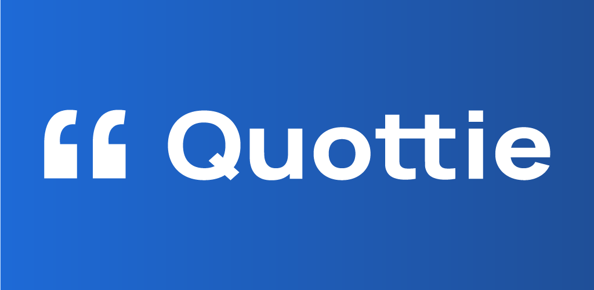
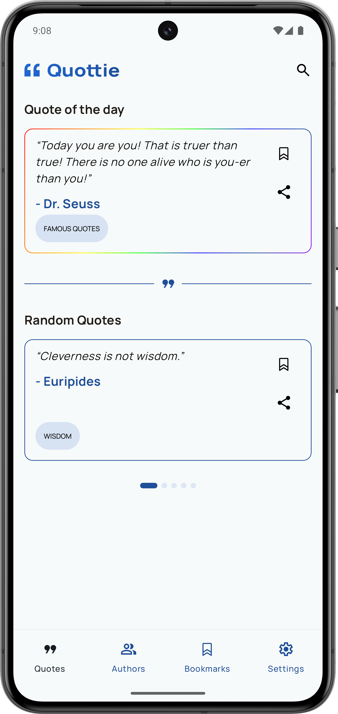
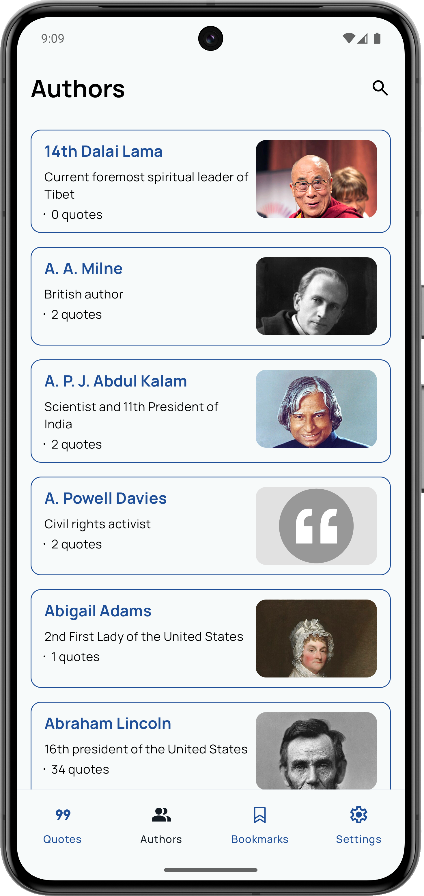
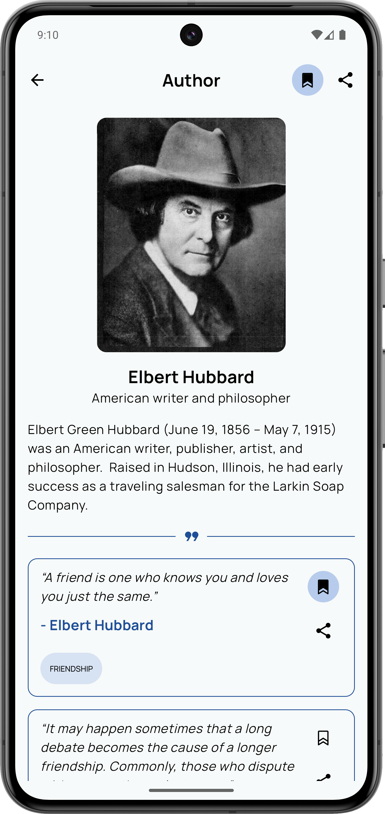

Quottie: Quote of the Day
============

This is the repository for the [Quottie: Quote of the Day](https://github.com/ngapp-dev/Quottie-KMP) Kotlin Multiplatform app. It is always updated and is under development.

**Quottie: Quote of the Day** is a mobile application that helps to find inspiring quotes & famous authors in one app. Bookmark your favorites easily!

The **Quottie: Your Personal Quote Companion** app is built using [Kotlin Multiplatform](https://kotlinlang.org/docs/multiplatform.html), specifically with [Compose Multiplatform](https://github.com/JetBrains/compose-multiplatform), and is under constant development.
The Android part is [available on the Play Store](https://play.google.com/store/apps/details?id=com.ngapp.quottie). The iOS part is in the publishing stage. We are actively writing tests, updating libraries, and implementing new solutions. Currently, we are focused on enhancing the app’s stability and performance through comprehensive testing, including screenshot testing and benchmarking.

In the near future, we plan to expand the app’s capabilities and features even further to provide users with an enriched experience.

# Features

**Quottie: Quote of the Day** is your ultimate source for daily inspiration! 🌟 Dive into a curated collection of uplifting quotes that motivate and encourage you every day. Whether you’re looking for wisdom from famous authors or a quick boost of positivity, Quottie has you covered. All rights to the application belong to [NGApps Dev](https://github.com/ngapp-dev).

📅 Quote of the Day
Start each day with inspiration! Quottie delivers a handpicked “Quote of the Day,” setting the tone for positivity and reflection. Let these powerful words guide and uplift you throughout the day.

🔄 Endless Inspiration with Random Quotes
In need of a quick boost? The Random Quotes feature offers endless scrolling, so you can keep discovering new and inspiring quotes at your own pace. With every scroll, you’ll uncover fresh insights and motivation.

👤 Explore Iconic Authors
Quottie goes beyond quotes. Discover more about the authors behind them! Browse through the profiles of famous authors, learn about their lives, and dive into their unique perspectives on life, success, and happiness.

🔍 Find Exactly What You’re Looking For
Easily search for quotes on specific topics, authors, or keywords. Whether it’s wisdom about life, success, or happiness, Quottie makes finding the perfect quote simple and quick!

📌 Bookmark Your Favorites
Build a personalized collection of quotes and authors that resonate with you. With bookmarks, you’ll always have easy access to the quotes you love most.

## Screenshots

  
  
  

## Libraries used

Types: **KMP** - multiplatform library used from shared code (`commonMain`, Android and iOS), **Android** - Android-only library (`androidMain` / `androidApp`), **Gradle plugin** - build tooling, **Test** - test-only dependency.

| | Library | Version | Type | Used for |
|---|---|---|---|---|
| 🧬 | [Kotlin Multiplatform](https://kotlinlang.org/docs/multiplatform.html) | 2.4.21 | Gradle plugin | sharing code between Android and iOS |
| 🧩 | [Compose Multiplatform](https://github.com/JetBrains/compose-multiplatform) | 1.12.1 | KMP | shared UI |
| 📐 | [Material 3 Adaptive](https://www.jetbrains.com/help/kotlin-multiplatform-dev/compose-adaptive-layouts.html) | 1.3.0 | KMP | adaptive layouts and navigation suite |
| 🧭 | [Navigation Compose](https://www.jetbrains.com/help/kotlin-multiplatform-dev/compose-navigation-routing.html) | 2.9.2 | KMP | navigation |
| ♻️ | [Lifecycle ViewModel](https://www.jetbrains.com/help/kotlin-multiplatform-dev/compose-viewmodel.html) | 2.11.0 | KMP | shared ViewModels |
| 🌐 | [Ktor](https://ktor.io/) | 3.6.0 | KMP | networking (OkHttp engine on Android, Darwin on iOS) |
| 📦 | [Kotlinx Serialization](https://github.com/Kotlin/kotlinx.serialization) | 1.11.0 | KMP | content negotiation |
| ⚡ | [Kotlinx Coroutines](https://github.com/Kotlin/kotlinx.coroutines) | 1.11.0 | KMP | asynchronous work |
| 🕒 | [Kotlinx Datetime](https://github.com/Kotlin/kotlinx-datetime) | 0.8.0 | KMP | dates and time |
| 💉 | [Koin](https://insert-koin.io/) | 4.2.2 | KMP | dependency injection |
| 🗃️ | [DataStore](https://developer.android.com/kotlin/multiplatform/datastore) + [Wire](https://github.com/square/wire) | 1.2.1 / 7.1.0 | KMP | storing user preferences in Protobuf |
| 🛢️ | [Room](https://developer.android.com/kotlin/multiplatform/room) + [SQLite Bundled](https://developer.android.com/kotlin/multiplatform/sqlite) | 2.8.5 / 2.7.1 | KMP | databasing |
| 📃 | [Paging (Cash App)](https://github.com/cashapp/multiplatform-paging) | 3.3.0-alpha02-0.5.1 | KMP | paginated quote and author lists |
| 🏞️ | [Coil 3](https://github.com/coil-kt/coil) | 3.6.3 | KMP | loading images |
| 🌍 | [moko-resources](https://github.com/icerockdev/moko-resources) | 0.26.4 | KMP | shared strings, images, fonts and files |
| 🎞️ | [Kottie](https://github.com/ismai117/kottie) | 2.3.0 | KMP | Lottie animations |
| 🪟 | [Compose WebView Multiplatform](https://github.com/KevinnZou/compose-webview-multiplatform) | 2.0.3 | KMP | privacy policy and terms screens |
| 🧾 | [Napier](https://github.com/AAkira/Napier) | 2.7.1 | KMP | logging |
| 🚀 | [Core Splashscreen](https://developer.android.com/develop/ui/views/launch/splash-screen) | 1.2.0 | Android | splash screen |
| ⬆️ | [Play In-App Updates](https://developer.android.com/guide/playcore/in-app-updates) / [In-App Review](https://developer.android.com/guide/playcore/in-app-review) | 2.1.0 / 2.0.2 | Android | app updates and reviews |
| 🛠️ | [Android Gradle Plugin](https://developer.android.com/build/releases/gradle-plugin) | 9.4.1 | Gradle plugin | Android build (`com.android.kotlin.multiplatform.library` for shared modules) |
| ⚙️ | [KSP](https://github.com/google/ksp) | 2.3.12 | Gradle plugin | Room and Koin code generation |
| 🔑 | [BuildKonfig](https://github.com/yshrsmz/BuildKonfig) | 0.23.0 | Gradle plugin | build config for shared code (API base URLs, ad ids) |
| 🔍 | [Detekt](https://github.com/detekt/detekt) / [Kover](https://github.com/Kotlin/kotlinx-kover) | 1.23.8 / 0.9.11 | Gradle plugin | static analysis and code coverage |
| 🧪 | [Kotlin Test](https://kotlinlang.org/api/core/kotlin-test/), [Turbine](https://github.com/cashapp/turbine), [Ktor MockEngine](https://ktor.io/docs/client-testing.html), [Okio FakeFileSystem](https://square.github.io/okio/) | | Test | unit tests |
| 📱 | [AndroidX Test](https://developer.android.com/training/testing) / [Compose UI Test](https://developer.android.com/develop/ui/compose/testing) | 1.7.0 / 1.12.1 | Test | instrumented tests |

The full list of versions is in [`gradle/libs.versions.toml`](gradle/libs.versions.toml). The project builds with Gradle 9.8.1 and JDK 17+.

## Services used
- 📊 [Firebase Analytics](https://github.com/firebase/firebase-android-sdk) - for analytics logging (Android)
- 🔎 [Firebase Crashlytics](https://github.com/firebase/firebase-android-sdk) - for crashlytics logging (Android)
- 🔒 [Google UMP](https://developers.google.com/admob/ump/android/quick-start) - for showing consent screen (Android)
- 📢 [Google AdMob](https://developers.google.com/admob/android/sdk) - for showing ads (Android)
- 💬 [Quotable](https://github.com/lukePeavey/quotable) - quotes and authors API, served from a [Cloudflare Workers](https://workers.cloudflare.com/) mirror
- 📖 [Wikipedia API](https://www.mediawiki.org/wiki/API:Main_page) - for author details
- 🐙 [GitHub API](https://docs.github.com/en/rest) - for the developer profile on the About screen

## Architecture

The **Quottie: Your Personal Quote Companion** app follows the official architecture guidance which is described in detail in the [Now in Android app architecture learning journey](https://github.com/android/nowinandroid/blob/main/docs/ArchitectureLearningJourney.md), adapted to Kotlin Multiplatform.

The project uses convention plugins in `build-logic` and a modularized structure:
- 🤖 `androidApp` - the Android application: `MainActivity`, `Application`, manifest, Firebase setup
- 📱 `composeApp` - the shared application shell: root composable, navigation host, Koin modules, and the iOS framework
- 🍏 `iosApp` - the iOS application (Xcode project) that hosts the shared Compose UI
- 🧱 `core:*` - shared KMP modules: analytics, common, data, database, datastore, design system, domain, model, network, UI components
- 🧩 `feature:*` - one KMP module per feature, with its UI, ViewModel and state in `commonMain`
- 🌍 `resources` - shared strings, images and fonts

Platform-specific code, such as ads, analytics and sharing, lives in `androidMain` and `iosMain` behind `expect`/`actual` declarations.

## Tests

- `./gradlew testAndroidHostTest` - unit tests of the shared modules (`commonTest`), run on the JVM
- `./gradlew connectedAndroidDeviceTest` - instrumented tests (`androidDeviceTest`): Room DAOs, DataStore, ViewModels and Compose UI, run on a device or emulator

## UI
The app was designed using [Material 3 guidelines](https://m3.material.io/).

The screens and UI elements are built entirely with [Compose Multiplatform](https://github.com/JetBrains/compose-multiplatform), so the same UI runs on Android and iOS.

The app has theme modes, light and dark.

## Author

This application was developed by [NGApps Dev](https://github.com/ngapp-dev). I am continuously working on improving the functionality, optimizing the app's performance, and keeping the libraries up-to-date to ensure its stability and relevance.

You can reach me at [ngapps.developer@gmail.com](mailto:ngapps.developer@gmail.com), and feel free to follow my projects on [GitHub](https://github.com/ngapp-dev).

I welcome contributions from the community! Whether it's suggestions, bug fixes, or new features, feel free to open an issue or submit a pull request. Thank you for using the app and for your support!